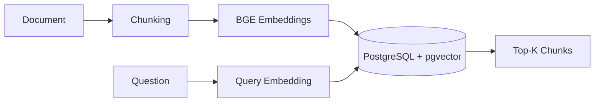
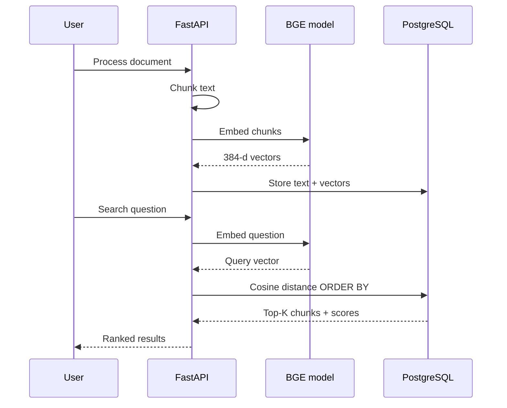
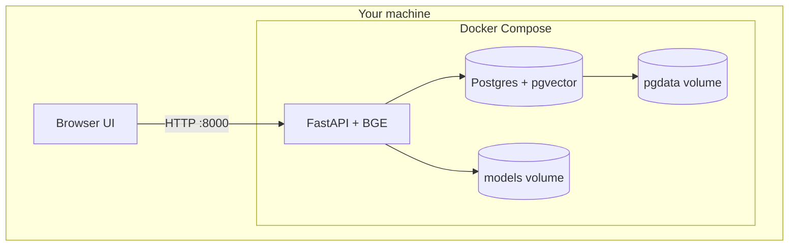

# RAG Visualizer

A local educational app that shows how **Retrieval-Augmented Generation (RAG)** works, one step at a time.

You paste a document, watch it become chunks, watch those chunks become vectors, see them stored in PostgreSQL with pgvector, then search with semantic similarity — all on your machine, with no API keys.

**Open the app:** [http://localhost:8000](http://localhost:8000)

---

## What is RAG?

Large language models answer from what they learned during training. They do not automatically know your private docs, and they can invent plausible-sounding facts (hallucinations).

**RAG** adds a retrieval step before answering:

1. Keep a knowledge base of your documents.
2. When a question arrives, find the most relevant passages.
3. Give those passages to the model as context.

This demo focuses on the retrieval pipeline (not the final LLM answer):

**Document → Chunking → Embeddings → Vector DB → Semantic Search → Results**



---

## Why chunking?

Embedding an entire long document as one vector mixes many topics together. Small chunks let search return only the paragraph that matches the question.

This app uses a simple character-based split with optional overlap so sentences cut at a boundary can still appear whole in a neighbouring chunk.

---

## What are embeddings?

An embedding turns text into a fixed-length list of numbers that captures meaning. Similar meanings tend to produce similar vectors — even when the wording differs.

This project uses the local model **BAAI/bge-small-en-v1.5** via Sentence Transformers:

- Runs on CPU
- Output size: **384 dimensions**
- No OpenAI, Gemini, or other cloud embedding APIs

The model is downloaded once into a Docker volume and reused after that, including offline.

---

## What does a vector database do?

PostgreSQL with the **pgvector** extension stores each chunk’s original text next to its embedding. When you search, it finds vectors close to your question and returns the matching text.

| Column        | Purpose                          |
|---------------|----------------------------------|
| `id`          | Database row id                  |
| `chunk_id`    | Chunk index in the document      |
| `content`     | Original text                    |
| `embedding`   | `vector(384)` from BGE           |
| `document_hash` | Detects duplicate re-processing |

---

## How semantic search works

1. Embed the question with the same BGE model.
2. Compare the query vector to every stored chunk vector.
3. Return the top **K** most similar chunks (default 3, adjustable 1–10).

Search always uses the full **384-dimensional** vectors. The optional 2D map is PCA for teaching only — it is never used for retrieval.



---

## How cosine similarity works

Cosine similarity measures the **angle** between two vectors:

\[
\cos(\theta) = \frac{A \cdot B}{\|A\| \|B\|}
\]

- **1** → same direction (very similar meaning)
- **0** → unrelated
- Negative → opposite directions

BGE outputs are normalized to length 1, so similarity is the dot product. pgvector’s `<=>` operator is cosine **distance** (`1 − similarity`); ordering by smallest distance returns the closest chunks.

---

## How this project demonstrates the pipeline

| Stage           | What you see                                      |
|-----------------|---------------------------------------------------|
| Document        | Paste text or load the AI/RAG sample              |
| Chunking        | Highlighted source + per-chunk cards              |
| Embeddings      | Model name, dim count, vector preview / expand    |
| Vector Storage  | Live `chunks` table view + DB stats               |
| Retrieval       | Question → query vector → pgvector search         |
| Results         | Ranked cards with similarity progress bars        |
| Vector map      | Optional PCA scatter of chunks (+ query)          |

Stack (all local):

- **Backend:** Python, FastAPI
- **Frontend:** HTML, CSS, vanilla JavaScript (served by FastAPI)
- **Embeddings:** `BAAI/bge-small-en-v1.5` (Sentence Transformers)
- **Database:** PostgreSQL 16 + pgvector
- **Runtime:** Docker Compose

No LangChain, LlamaIndex, cloud APIs, or API keys.

---

## Prerequisites

- [Docker](https://docs.docker.com/get-docker/) with Docker Compose
- ~4 GB disk for the image + model (first run downloads PyTorch CPU wheels and BGE)
- Ports **8000** (app) and **5433** (optional Postgres on the host)

---

## How to run

From the project root:

```bash
docker compose up --build
```

First start will:

1. Build the backend image (installs CPU PyTorch + dependencies)
2. Start Postgres with pgvector and run `database/init.sql`
3. Wait until Postgres is healthy
4. Load BGE into the `models` volume (download once)
5. Serve the UI and API on port 8000

Then open:

**http://localhost:8000**

Useful commands:

```bash
docker compose up --build
docker compose down
docker compose down -v
docker compose logs -f backend
```

`down -v` removes the Postgres and model volumes (you would need to re-download the model).

---

## Try it

1. Click **Load sample document** (or paste your own text).
2. Adjust chunk size / overlap if you want.
3. Click **Process document** and watch stages light up.
4. Ask something like *“What is Retrieval Augmented Generation?”*
5. Inspect ranked chunks, scores, and the optional vector map.
6. Use **Reset database** to clear demonstration data.

---

## API overview

| Method   | Path            | Purpose                                      |
|----------|-----------------|----------------------------------------------|
| `GET`    | `/api/health`   | Model + DB readiness                         |
| `POST`   | `/api/process`  | Chunk, embed, store document                 |
| `POST`   | `/api/search`   | Embed query, cosine search, top-K results    |
| `GET`    | `/api/stats`    | Chunk / vector counts and connection status  |
| `GET`    | `/api/chunks`   | Stored rows (optional PCA projection)        |
| `DELETE` | `/api/reset`    | Clear the `chunks` table                     |

Example search:

```bash
curl -X POST http://localhost:8000/api/search \
  -H "Content-Type: application/json" \
  -d "{\"query\": \"What is Retrieval Augmented Generation?\", \"top_k\": 3}"
```

---

## Project layout

```
rag-analyzer/
├── backend/
│   ├── main.py
│   ├── chunking.py
│   ├── embeddings.py
│   ├── database.py
│   ├── retrieval.py
│   └── requirements.txt
├── frontend/
│   ├── index.html
│   ├── style.css
│   └── app.js
├── database/
│   └── init.sql
├── Dockerfile
├── docker-compose.yml
├── .dockerignore
└── README.md
```

---

## Architecture



Everything stays on localhost after the first model download. Happy exploring.
